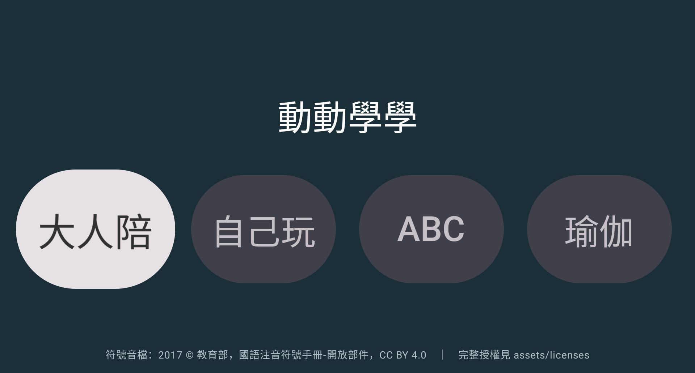
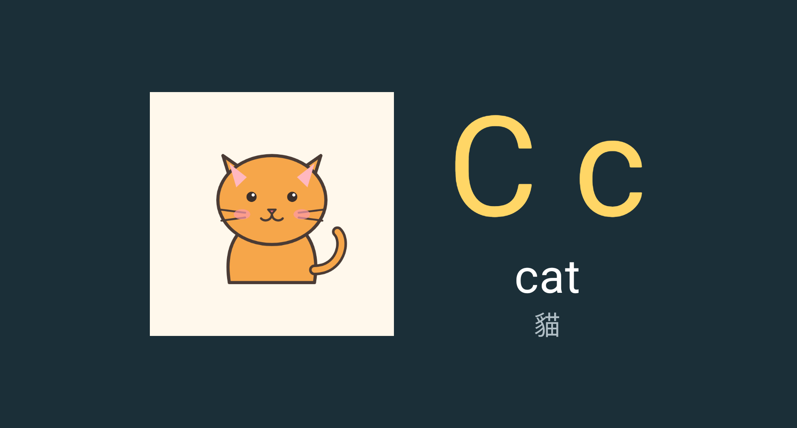
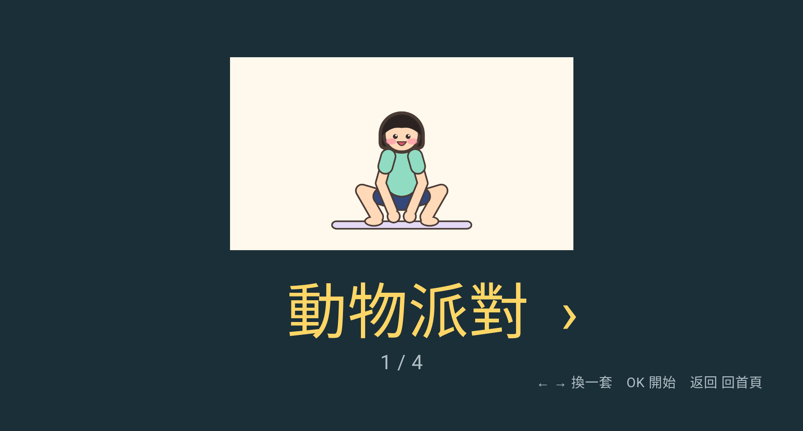
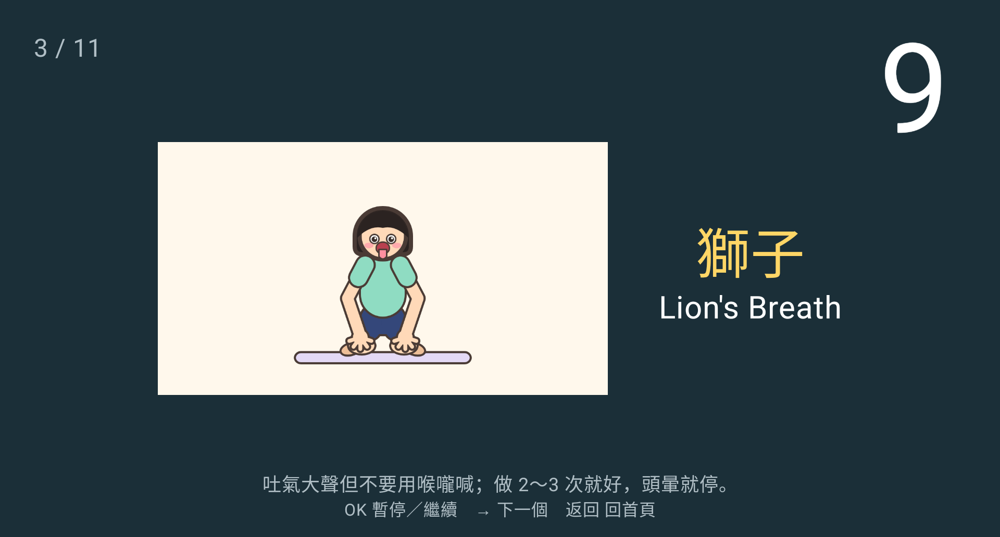

# 動動學學（Learn & Move）：Android TV 上的注音、ABC 與兒童瑜伽

動動學學是給學齡前孩子用的 Android TV／Google TV 教具 App。孩子可以學注音、學 ABC，也可以跟著做瑜伽。用電視遙控器就能玩。

- **離線**：App 沒有網路權限，所有圖和聲音都在 APK 裡。
- **無廣告**：沒有廣告，也沒有內購。
- **不收集資料**：練習紀錄只存在電視本機，不上傳。

> English summary is at the [bottom](#english).

## 截圖

| 首頁 | 注音 |
|---|---|
|  |  |
| **ABC** | **瑜伽：選一套** |
|  |  |
| **瑜伽：跟著做** | |
|  | |

## 有哪些玩法

首頁有四個按鈕：

| 按鈕 | 內容 |
|---|---|
| 大人陪 | 大人陪孩子一起練注音。一次一個單元，大人用上／下鍵記「答對／再練」。 |
| 自己玩 | 孩子自己按。任何方向鍵都換下一張卡並播音。10 分鐘自動結束。 |
| ABC | 26 個英文字母，每個字母有幾個例詞和插圖。玩法同自己玩。 |
| 瑜伽 | 跟著口令做動作。開場會提醒「請大人陪在旁邊」。 |

### 大人陪

- 開頭先選「從第幾單元開始」。預設是上次練的單元。
- 左右鍵換卡，確定鍵播音。
- 上鍵記「答對」，下鍵記「再練」。按「再練」的卡會排到本輪最後。
- 新卡做完會打亂順序再複習一輪。
- 連續 2 次每張卡第一次就答對，或同一單元練滿 4 次，下次自動進下一單元。
- 10 分鐘到會自動結束，下次從沒做完的卡接著做。

### 自己玩與 ABC

- 任何方向鍵或確定鍵都換下一張。幼兒還分不清方向鍵，任何鍵都有反應比較不挫折。
- 每個符號／字母的例詞連續出完，再換下一個。下次從上次那張接著。
- 10 分鐘到停在「今天練完了」。只能按返回鍵回首頁。

### 瑜伽

- 每個姿勢先播口令，口令播完才倒數。
- 確定鍵暫停／繼續，右鍵跳下一個，返回鍵回首頁。
- 不偵測動作、不計分。請大人在旁邊看著孩子。

## 安裝

App 沒有上架 Google Play，要用「側載」安裝。側載的意思是：不經過商店，直接把 APK 檔裝進電視。

下面兩種方法選一種就好。

### 方法一：一般家長（用 Downloader App）

不需要電腦。

1. **在電視上安裝 Downloader。** 打開 Google Play，搜尋「Downloader」（作者 AFTVnews），安裝。
2. **開開發人員模式。** 設定 > 系統 > 關於 > 在「Android TV OS 版本號」上連按確定鍵約 7 次。畫面出現「你現在是開發人員」就成功了。
3. **允許 Downloader 安裝 App（開啟未知來源）。** 設定 > 應用程式 > 安全性與限制 > 不明來源 > 打開 Downloader。
   - 「未知來源」是 Android 的安全開關。預設只能從 Play 商店裝 App。打開後，這個 App 才能幫你安裝下載的 APK。
   - 選單名稱依電視品牌和系統版本不同，可能叫「安裝不明應用程式」。
4. **下載 APK。** 打開 Downloader，在網址欄輸入本專案 GitHub Releases 的 APK 下載網址：
   ```
   https://github.com/keeponfirst/learn-and-move-tv/releases/latest/download/learn-and-move-tv.apk
   ```
   <!-- TODO：repo 建好、發 Release 後確認網址可下載，或附短網址。 -->
5. **安裝。** 下載完會跳出安裝畫面，選「安裝」。
6. **刪掉 APK 檔。** 安裝完 Downloader 會問要不要刪除檔案，選「刪除」，省空間。
7. **（建議）關掉未知來源。** 回到步驟 3 的地方，把 Downloader 關掉。
8. **開 App。** 主畫面「您的應用程式」列會出現「動動學學」。找不到就到 設定 > 應用程式 > 查看所有應用程式 > 動動學學。

### 方法二：工程師（用 adb）

需要電腦裝好 [Android SDK Platform Tools](https://developer.android.com/tools/releases/platform-tools)。電視與電腦要在同一個 Wi-Fi。

1. **開開發人員模式。** 同方法一的步驟 2。
2. **開無線偵錯。** 設定 > 系統 > 開發人員選項 > 開「無線偵錯」（Wireless debugging）。需要 Android TV 13 以上。
3. **配對。** 在無線偵錯裡選「使用配對碼配對裝置」。電視會顯示 IP:port 與 6 位數配對碼。電腦執行：
   ```
   adb pair <電視IP>:<配對port>
   ```
   輸入配對碼。
4. **連線。** 用無線偵錯畫面上「IP 位址和通訊埠」那一組（和配對 port 不同）：
   ```
   adb connect <電視IP>:<連線port>
   adb devices
   ```
5. **安裝。**
   ```
   adb install -r learn-and-move-tv.apk
   ```
   自己建置的話，APK 在 `app/build/outputs/apk/debug/app-debug.apk`。

**連不上時的備用法（5555 port）：** 有些電視配對成功後，連線 port 一直 `failed to connect`。這時改連傳統的 adb port：

```
adb connect <電視IP>:5555
```

電視會跳「允許 USB 偵錯？」，選「一律允許這台電腦」。電視重開機或關掉無線偵錯後可能會斷。連不上時先跑 `adb mdns services` 看電視廣播的 port。

## 建置

需要 JDK 17 以上與 Android SDK（compileSdk 36）。

```
./gradlew assembleDebug        # 產出 app/build/outputs/apk/debug/app-debug.apk
./gradlew testDebugUnitTest    # 單元測試
bash scripts/check-clean.sh    # 發布前檢查
```

### Release 簽章

repo 裡沒有任何金鑰。沒有 `keystore.properties` 時只能建 debug 版。要建 release 版，先自己建金鑰：

1. 建 keystore（放在 repo 根目錄，檔名照 `.gitignore` 會被忽略）：
   ```
   keytool -genkeypair -v -keystore release.jks -alias zhuyin -keyalg RSA -keysize 4096 -validity 10000
   ```
2. 在 repo 根目錄建 `keystore.properties`：
   ```
   storeFile=release.jks
   storePassword=<你的密碼>
   keyAlias=zhuyin
   keyPassword=<你的密碼>
   ```
3. 建置：
   ```
   ./gradlew assembleRelease      # 產出 app/build/outputs/apk/release/app-release.apk
   ```

`keystore.properties`、`*.jks`、`*.keystore` 都在 `.gitignore` 裡。不要提交它們。金鑰弄丟就不能更新已安裝的 App，請自己備份。

### 重產 TV banner

banner 用 Noto Sans TC（SIL OFL 1.1）。repo 不收錄字型檔，請自己下載：https://fonts.google.com/noto/specimen/Noto+Sans+TC

```
pip install pillow
python3 tools/make_banner.py app/src/main/res/drawable-xhdpi/banner.png --font <NotoSansTC 字型檔路徑>
```

也可以設環境變數 `BANNER_FONT` 指定字型檔，省略 `--font`。

### 模擬器截圖

```
bash scripts/emulator-screenshots.sh            # 含等 10 分鐘的結束頁
QUICK=1 bash scripts/emulator-screenshots.sh    # 跳過結束頁
```

需要 SDK 的 `system-images;android-34;android-tv;arm64-v8a`。截圖輸出到 `build/screenshots/`。

## 放自己錄的聲音

App 內建合成語音。家長可以換成自己錄的聲音，孩子會更有親切感。

1. 用手機錄音，存成 `.m4a`。一個檔一段話。
2. 檔名照下表。完整清單見 `app/src/main/assets/cards.json` 的 `audio` 欄位。

   | 種類 | 檔名例 | 內容 |
   |---|---|---|
   | 符號音 | `s_01_b.m4a` | ㄅ |
   | 關鍵字 | `k_01_baba.m4a` | 爸爸 |
   | 答對 | `p_correct.m4a` | 「答對了！」 |
   | 再聽一次 | `p_listen_again.m4a` | 「再聽一次。」 |
   | 下一張 | `p_next.m4a` | 「換下一張。」 |
   | 再練一次 | `p_practice_again.m4a` | 「再練一次。」 |
   | 休息 | `p_rest.m4a` | 「我們休息一下。」 |
   | 練完了 | `p_done.m4a` | 「今天練完了！」 |

3. 把檔案放進 `app/src/main/assets/audio/custom/`。
4. 重新建置並安裝。

播放順序：

- 符號音：自錄檔 → 教育部手冊音檔 → 靜音。
- 關鍵字與固定語句：自錄檔 → 內建合成語音 → 靜音。
- 找不到檔或檔案壞掉都只會靜音，不會當機。

## 素材授權摘要

程式碼採 [MIT License](LICENSE)。素材的授權各自不同，細節見 [NOTICE](NOTICE)。

| 素材 | 來源 | 授權 |
|---|---|---|
| 注音符號音檔 `audio/moe/F1.WAV`…`F37.WAV` | 教育部《國語注音符號手冊》開放部件 | CC BY 4.0 |
| 內建合成語音（關鍵字、固定語句、ABC、瑜伽口令） | Google Cloud Text-to-Speech 合成，不是真人錄音 | MIT |
| 插圖（注音例詞、ABC、瑜伽） | 本專案以程式繪製（SVG 轉 PNG），沒有 AI 生圖 | MIT |
| TV banner | `tools/make_banner.py` 產生，文字用 Noto Sans TC | MIT（字型為 SIL OFL 1.1） |
| 第三方套件（AndroidX、Kotlin 等） | 隨 APK 散布 | Apache 2.0；protobuf-lite 為 BSD 3-Clause |

**音檔請勿用於訓練語音模型。**

第三方授權全文在 `LICENSES/`。APK 裡的 `assets/licenses/` 也有同樣的 NOTICE、套件清單（THIRD_PARTY.md）和授權全文。

教育部音檔的標示：

- 2017 © 教育部，國語注音符號手冊-開放部件。
- 此素材依「創用CC 姓名標示 4.0 國際版本」授權條款進行公眾釋出，使用者於遵守本條款各項規定之前提下，得利用之。
- 創用CC 姓名標示 4.0 國際版授權條款：https://creativecommons.org/licenses/by/4.0/deed.zh_TW

App 首頁底部也有一行標示。

## 文件

- `docs/decisions.md`：技術選擇與理由。

---

## English

**Learn & Move** (動動學學) is an Android TV / Google TV app for preschoolers. It teaches Zhuyin (Bopomofo), the ABCs, and simple kids yoga. You play it with the TV remote.

- Works offline. The app has no network permission.
- No ads and no in-app purchases.
- Collects no data. Practice records stay on the TV.

**Install.** The app is not on Google Play. Download the APK from GitHub Releases. Then sideload it with the Downloader app, or with `adb install`. See the Chinese steps above.

**Build.** Run `./gradlew assembleDebug`. Release builds need your own `keystore.properties`. No signing key is in this repo.

**Custom voice.** Put your own `.m4a` recordings in `app/src/main/assets/audio/custom/`. Use the same file names as the bundled audio. Then rebuild.

**License.** Code is MIT. Assets have their own licenses. See [NOTICE](NOTICE). Voice clips are synthesized with Google Cloud Text-to-Speech. Do not use them to train speech models. Third-party license texts are in `LICENSES/` and in the APK under `assets/licenses/`.
